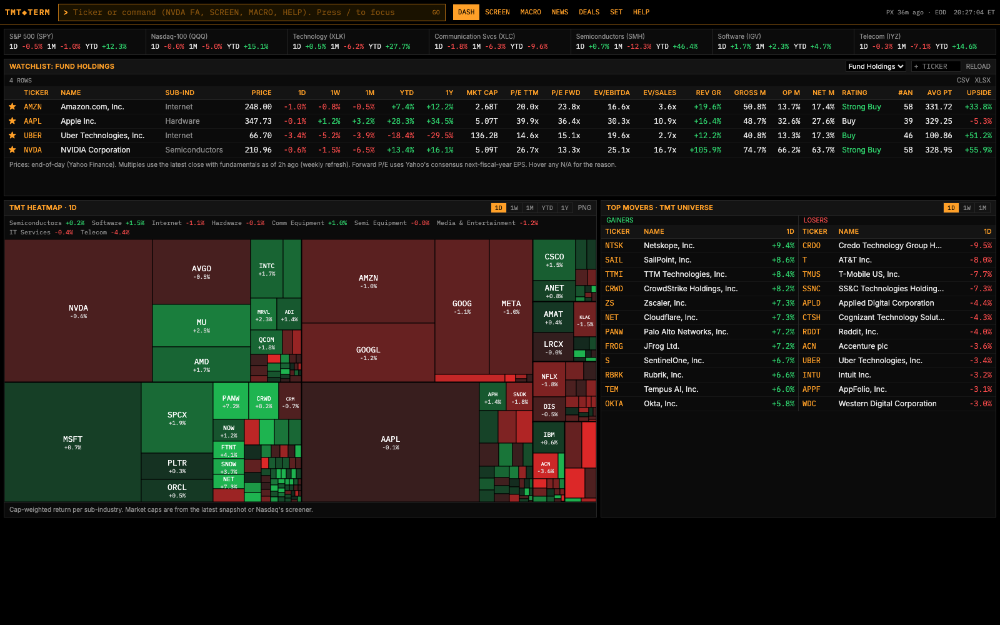
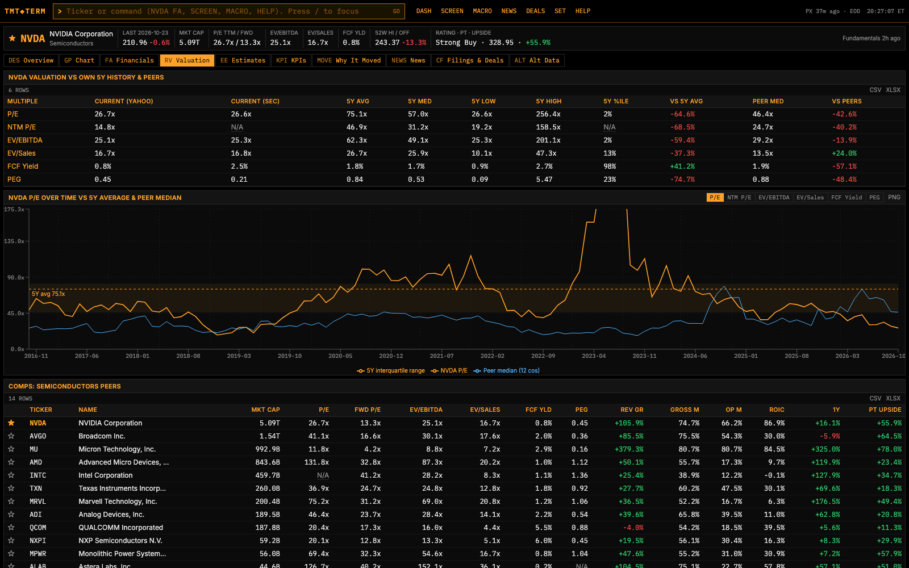
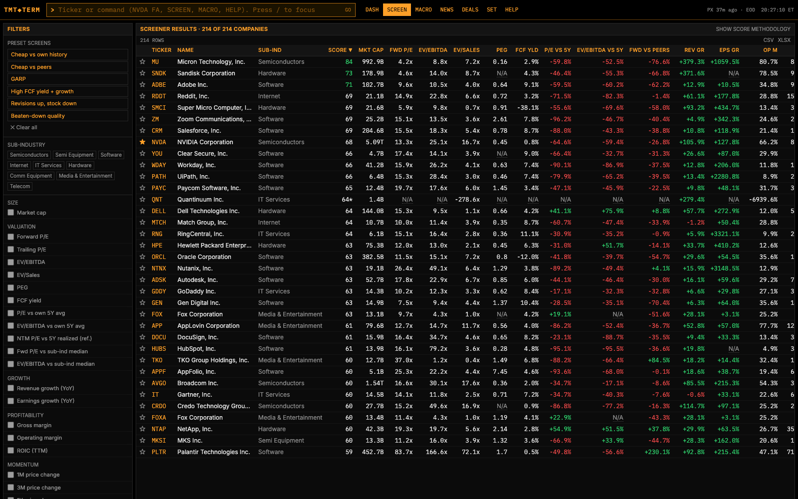
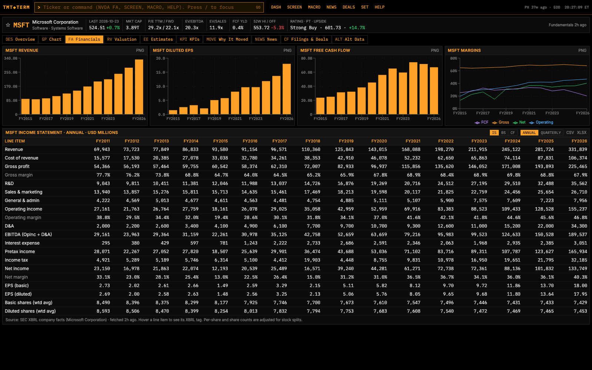

# TMT Terminal

A Bloomberg-style equity research terminal for the Technology, Media & Telecom sector. I built it to research my university student-managed investment fund's TMT holdings and to screen the sector for undervalued names to pitch.

It runs locally for **$0**, using only free data (SEC EDGAR XBRL, FRED, Yahoo Finance, Finnhub, GDELT and others), and is upfront about missing or estimated data: every N/A explains why.



**Highlights**
- **Universe of ~215 US TMT companies**, built automatically from S&P 500/400 constituents plus larger Nasdaq names and tagged into peer groups (semis, software, internet, telecom…).
- **16 years of financial statements** parsed directly from SEC XBRL filings, with quarterly values derived from year-to-date filings, split adjustments, and restatements taken from the latest filing.
- **Valuation vs. history and peers:** P/E, EV/EBITDA, EV/Sales, FCF yield and PEG rebuilt month by month with no look-ahead (45-day filing lag), compared with the company's own 5-year range and its peer median, plus auto-generated comps.
- **Screener** with preset ideas (cheap vs. own history, cheap vs. peers, GARP, FCF yield + growth, positive revisions but falling price, beaten-down quality) and a transparent composite value score.
- **"Why did it move?"** detects statistically significant moves (including moves vs. the sector ETF) and lines up the news, SEC filings and earnings around each one, with an optional citation-grounded AI summary under a hard monthly spend cap.
- Macro dashboard (FRED) with each holding's beta to rates and indices, M&A filing flags (8-K Items 1.01/2.01), XBRL-derived KPIs, and pluggable alternative-data proxies.
- Every chart exports to PNG and every table to CSV/Excel for pitch decks.

| Valuation vs own history & peers | Screener |
|---|---|
|  |  |

| Financial statements from SEC XBRL |
|---|
|  |

**Stack:** Python, FastAPI, pandas, SQLite · React, TypeScript, Vite, Tailwind · TradingView Lightweight Charts, Recharts.

## Run it

**One-time setup** (already done on this Mac):

| Tool | Install |
|---|---|
| [uv](https://docs.astral.sh/uv/) (Python manager) | `curl -LsSf https://astral.sh/uv/install.sh \| sh` (installs to `~/.local/bin`) |
| Node.js 22 LTS | the macOS installer from [nodejs.org](https://nodejs.org), or the tarball in `~/.local/node` |

Then:

```bash
cp .env.example .env        # add SEC_USER_AGENT (required) and any free keys
scripts/start.sh            # API on :8000 + UI on :5173, opens your browser
```

The first launch downloads 10 years of daily prices for the whole universe (about 2 minutes). Fundamentals fill in as you open companies and as the nightly job runs.

**Nightly refresh** (recommended): `scripts/nightly.sh` crawls the whole universe within free-tier limits (about 45 minutes the first time, then incremental). Run it by hand, click *Run nightly crawl now* on the SET page, or schedule it daily at 2:30am:

```bash
scripts/install_nightly.sh            # uses macOS launchd; --uninstall to remove
```

**Your fund's holdings:** edit `config/watchlists.yaml` (the only setup), or use the ☆ star on any company page.

## API keys (all free)

| Key | Needed for | Without it |
|---|---|---|
| `SEC_USER_AGENT` | SEC EDGAR: financials, filings, segments, KPIs. Format: `Your Name you@school.edu` | Financials fall back to Yahoo (~4 years); filings tab empty |
| `FRED_API_KEY` ([get one](https://fred.stlouisfed.org/docs/api/api_key.html)) | MACRO page, rate sensitivity | Macro page shows how to add it; S&P/Nasdaq betas still work |
| `FINNHUB_API_KEY` ([get one](https://finnhub.io/register)) | ~1 year of company news history, M&A news category, recommendation fallback | News comes from Yahoo (recent only) + GDELT (last ~90 days) |
| `FMP_API_KEY` ([get one](https://site.financialmodelingprep.com/developer/docs)) | Fallback price targets, long-range annual estimates | Those panels say "no source" |
| `ANTHROPIC_API_KEY` (optional, paid) | "✦ Explain" AI summaries on big moves | Headlines/filings only |

## Commands

Type in the command bar (press `/` or `Esc` from anywhere):

| Command | Opens |
|---|---|
| `NVDA` | Company overview: description, segments, peers |
| `NVDA GP` | Candlestick chart, volume, 50/200D MA, earnings + big-move + M&A markers; compare vs XLK/XLC/SMH/IGV/peers |
| `NVDA FA` | Income statement / balance sheet / cash flow, annual & quarterly, up to ~16 years; revenue/EPS/FCF/margin charts |
| `NVDA RV` | Valuation multiples vs own 5Y history and peer median over time, plus an auto comps table |
| `NVDA EE` | Consensus, revisions, beat/miss history, price-target range, rating changes |
| `UBER KPI` | Sector-specific KPI charts (software: RPO; semis: inventory days; telecom: leverage; ...), segment revenue/profit/margins, and company-reported metrics parsed from earnings releases (e.g. Uber gross bookings, take rate, trips, MAPCs, adj. EBITDA) |
| `NVDA MOVE` | "Why did it move?": detected big moves with a news/filing/earnings timeline and optional AI explain |
| `NVDA NEWS` / `NVDA CF` / `NVDA ALT` | Company news · filings & deals · alt-data proxies |
| `SCREEN` | Screener with 6 preset screens, sliders, composite value score |
| `MACRO` · `NEWS` · `DEALS` · `TOP` · `SET` · `HELP` | Macro dashboard · news feed · sector M&A feed · movers · settings/status · help |

**Exports:** every chart panel has a **PNG** button (2x resolution, black background, ready for slides), and every table has **CSV** and **XLSX** buttons.

## Data sources and rate limits

Free-tier limits were checked in October 2026, and every source is throttled below its limit (`backend/app/ratelimit.py`).

| Source | Used for | Limit (our spacing) |
|---|---|---|
| Yahoo Finance via yfinance | Prices, profile, TTM ratios, consensus, revisions, targets, earnings dates | Unpublished, IP-throttled (1 call/s, batched price downloads) |
| SEC EDGAR company facts + submissions | Historical financials (backbone), filings, 8-K items | 10 req/s (0.15s) |
| SEC XBRL via edgartools | Segment/geography revenue, custom KPI tags | Same as above |
| FRED API | Macro series, 10Y yield for rate betas | 120/min (0.6s) |
| Finnhub | Company/merger news, rec trends, surprises | 60/min (1.1s) |
| Financial Modeling Prep | Fallback targets/estimates | 250/day (we cap at 200) |
| GDELT DOC API | News for move windows (last ~90 days), news-volume proxy | ~1 request / 5s |
| Wikipedia, Hacker News (Algolia), Google Trends, Reddit | Alt-data proxies | Light throttles; failures are cached for 6h |
| Wikipedia S&P 500/400 tables, Nasdaq screener | Universe (GICS sub-industries) | Monthly |

**Refresh cadence:** prices daily (top-up on startup) · fundamentals, estimates, and SEC financials weekly, except SEC financials re-download as soon as a new 10-Q/10-K is filed (checked daily for every company, and hourly when you open its Financials tab) · filings and news on demand (cached 6h) · universe monthly · AI explanations cached forever.

## Methodology notes

- **Universe:** S&P 500 and S&P 400 members in GICS Information Technology and Communication Services, plus US companies over $5B in Nasdaq's Technology/Telecom/media industries. That approximates the larger Russell 1000 names, since iShares blocks scripted downloads of IWB holdings. Tags, overrides, and exclusions are in `config/universe.yaml`.
- **One definition per multiple, everywhere** (dashboard, comps, screener, RV tab):
  - *Trailing* (P/E, EV/EBITDA, EV/Sales, FCF yield): SEC-reported TTM figures (sum of the last four filed quarters) with the latest close and total market cap across share classes. EV = market cap + debt − cash − short-term investments, with all balance-sheet items taken from the same quarter. Yahoo is used only when SEC data is missing or stale, and those values are marked ʏ with the basis shown on hover.
  - *Forward*: **NTM P/E** = price ÷ next-twelve-months consensus EPS (current- and next-fiscal-year consensus, time-weighted). **PEG** = NTM P/E ÷ consensus EPS growth from the current to the next fiscal year.
  - P/E above 200x shows as NM (earnings near zero).
- **Valuation history:** month-end prices with SEC-reported TTM figures, lagged 45 days to avoid look-ahead. Split-adjusted, with share-count scale errors in filings repaired. Negative denominators are NM and excluded from averages.
- **Forward P/E vs history:** historical consensus forward P/E isn't free, and consensus EPS is non-GAAP while SEC history is GAAP. So "cheap vs own history" uses trailing P/E and EV/EBITDA (GAAP-consistent). The NTM P/E row compares with the 5Y average of *realized* forward P/E (price ÷ next-12-month reported GAAP earnings) for reference only.
- **Value score:** universe-wide percentile ranks. Value 40%, Quality 20%, Growth 20%, Revisions & momentum 20%. Inputs and coverage are shown in the screener ("SHOW SCORE METHODOLOGY"). It's a heuristic for finding names to research, not a recommendation.
- **Significant moves:** daily |move| > 5% or > 2σ of trailing 1Y volatility; weekly > 10%; monthly > 20%; or a > 2σ (and > 3%) move vs the sub-industry ETF.

## What's missing on free data (known gaps)

- **Prices are end-of-day**, not real-time.
- **Forward-multiple history and estimate-revision history beyond 90 days** aren't available (see the realized-forward proxy above).
- **Subscriber/user counts, gross bookings, ARPU, churn, NRR** are almost never XBRL-tagged. For companies set up in `config/kpis.yaml` (Uber so far), they're parsed from the tables in each quarter's earnings release (8-K Exhibit 99.1), with each value linked to its source release; a quarter whose table layout doesn't match shows N/A rather than a guess. Which standard charts each sub-industry gets is set in the same file.
- **ISM PMI** is proprietary and not on FRED. The Chicago Fed National Activity Index is shown instead.
- **Yahoo's FCF** is levered free cash flow and can differ a lot from CFO − capex. The RV tab shows both the Yahoo and SEC-based figures.
- **News history:** without Finnhub, history is limited to recent Yahoo items plus GDELT's ~90-day window. With Finnhub, about 1 year. Older "why did it move" windows rely on filings and earnings dates.
- **Reddit** refuses unauthenticated API access (403) from most IPs. **Google Trends** (pytrends) is unofficial and often rate-limited. Both are labeled best-effort.
- **Foreign filers** (20-F/40-F, e.g. TSM, ASML) have no US-GAAP XBRL, so their financials fall back to Yahoo (~4 years).
- The **deals feed** is keyword-based, so expect false positives. Confirmed deals are the 8-K Item 1.01/2.01 and S-4/SC TO-T/DEFM14A flags.

## AI summaries (optional)

Set `ANTHROPIC_API_KEY` to enable **✦ Explain** on the MOVE tab. It uses `claude-haiku-5-5` (about $0.10 / $0.50 per million input/output tokens, roughly $0.0005 per explanation). Only the retrieved headlines, filings, and earnings for that window are sent, and the answer must cite them. It's labeled AI-generated, cached forever (never regenerated), and blocked once the month's spend plus the worst-case cost of the next call would exceed `AI_MONTHLY_CAP_USD` (default $0.25). Usage is on the SET page.

## Project layout

```
backend/   FastAPI app (app/), nightly job (jobs/nightly.py)
  app/sources/     yfinance, SEC, Finnhub, FMP, FRED, GDELT wrappers
  app/services/    universe, prices, fundamentals (XBRL), valuation, estimates, screener, moves, news, filings, macro, ai
  app/altdata/     pluggable alt-data proxies (one file per source)
frontend/  React + Vite + TypeScript + Tailwind; Lightweight Charts (prices), Recharts (everything else)
config/    watchlists.yaml, universe.yaml
data/      SQLite cache + gzipped SEC company facts (gitignored)
```

**Add an alt-data source:** create `backend/app/altdata/mysource.py` with an `AltSource` subclass that returns `[{"date", "value"}]`, then add it to `plugins()` in `altdata/__init__.py`. The ALT tab picks it up automatically.

## Troubleshooting

- **Lots of N/A right after setup:** the nightly crawl hasn't reached those names yet. Check progress on SET.
- **Yahoo rate-limited** (`Too Many Requests`): wait 15–30 minutes. Cached data keeps serving and is marked stale.
- **Reset everything:** stop the app and delete `data/`.
